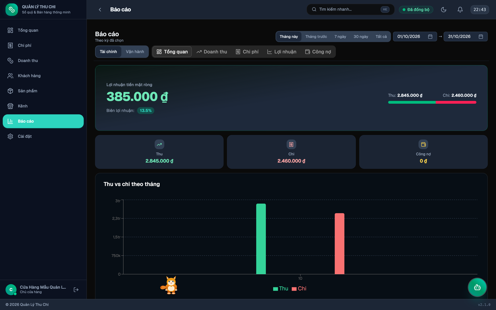

# Báo cáo & Phân tích

Phân tích hiệu quả kinh doanh đa chiều với các biểu đồ tương tác hiện đại.

---

## 1. Bộ lọc thời gian linh hoạt
Hỗ trợ các mốc thời gian thiết lập sẵn:
- **Tháng này**, **Tháng trước**
- **7 ngày gần nhất**, **30 ngày gần nhất**
- **Toàn thời gian (Tất cả)** hoặc chọn khoảng ngày tuỳ ý.

---

## 2. Các phân hệ báo cáo chuyên sâu

| Phân hệ | Nội dung & Chỉ số |
|:---|:---|
| **Chi phí** | Tổng chi, cơ cấu phân bổ theo 10 danh mục, xu hướng theo tháng |
| **Doanh thu** | Tổng tiền thu thực tế, so sánh đặt cọc và thanh toán đủ, tỷ trọng kênh |
| **Lợi nhuận (P&L)** | Lợi nhuận thuần = Doanh thu - Chi phí, biên lợi nhuận ròng |
| **Hàng hoá & Giá vốn** | Nhập hàng, tính giá vốn theo chuẩn FIFO, tồn kho và lợi nhuận gộp |
| **Công nợ khách hàng** | Theo dõi các đơn hàng chưa thanh toán, tuổi nợ và hạn thanh toán |
| **Khách hàng** | Top khách hàng chi tiêu nhiều nhất, tần suất quay lại |
| **Sản phẩm bán chạy** | Top sản phẩm có doanh số và số lượng bán tốt nhất |
| **Kênh bán hàng** | So sánh hiệu quả giữa các sàn TMĐT, mạng xã hội và bán lẻ tại tiệm |

---

→ [Trang chủ Wiki](Home) · [Dashboard](Dashboard)
