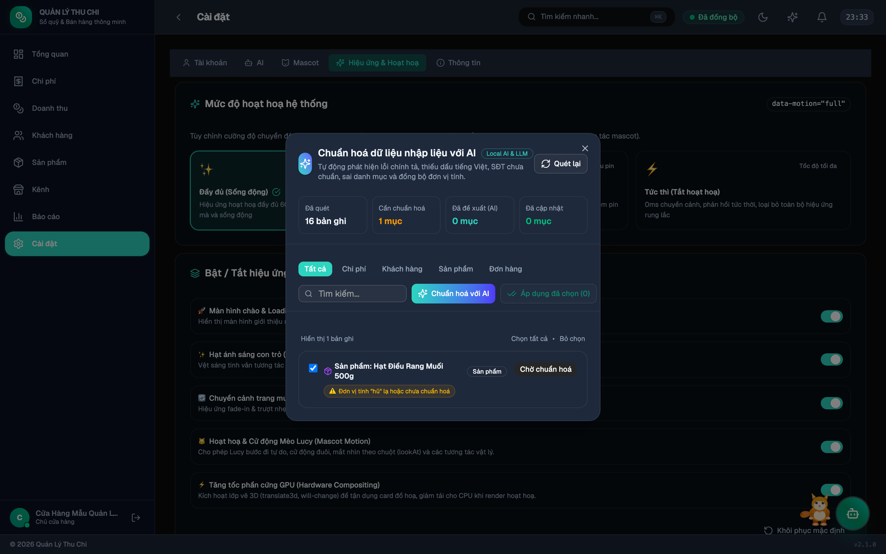

# Chuẩn hoá Dữ liệu Nhập liệu (AI Data Standardization)

Chức năng **Chuẩn hoá Dữ liệu Nhập liệu** giúp phát hiện và tự động làm sạch các bản ghi dữ liệu đã nhập trong hệ thống nhưng chưa đúng chuẩn hoặc bị lỗi chính tả, sai danh mục, sai định dạng số điện thoại hoặc đơn vị tính.

---

## 1. Vấn đề thường gặp khi nhập liệu thủ công

Trong quá trình vận hành cửa hàng bận rộn, người dùng thường gõ nhanh dẫn tới các lỗi dữ liệu:
- **Gõ thiếu dấu tiếng Việt hoặc viết hoa lộn xộn**: ví dụ *"mua cafe cau dat"*, *"TIEN DIEN THANG 10"*, *"chi tieu linh tinh"*.
- **Số điện thoại khách hàng không đồng nhất**: ví dụ `+84 901 234 567`, `090.123.4567`, `0901 234 567` gây khó khăn khi tìm kiếm và nhắn tin.
- **Danh mục chi phí phân loại sai**: ví dụ tiền điện, nước, internet nhưng để mặc định là `other` (Khác).
- **Đơn vị tính sản phẩm không đồng bộ**: ví dụ cùng một sản phẩm nhưng lúc nhập là *"LON"*, lúc *"lon"*, lúc *"ly"*, *"Chai"*, *"kg"*.

---

## 2. Các nhóm dữ liệu được chuẩn hoá

| Phân hệ | Dữ liệu được quét | Quy chuẩn chuẩn hoá |
|:---|:---|:---|
| 💰 **Chi phí (Expenses)** | Mô tả (`description`), Danh mục (`category`) | Viết hoa chữ cái đầu (Title Case), khôi phục dấu tiếng Việt, tự động nhận diện và gán đúng 10 danh mục chuẩn (`utilities`, `office`, `supplies`, `rent`, `salary`...). |
| 👥 **Khách hàng (Customers)** | Tên khách (`name`), Số điện thoại (`phone`) | Viết hoa tên riêng chuẩn tiếng Việt, chuẩn hoá số điện thoại về định dạng 10 chữ số sạch `0xxxxxxxxx` (bỏ mã quốc gia `+84`, khoảng trắng và dấu chấm). |
| 🏷️ **Sản phẩm (Products)** | Tên sản phẩm (`name`), Đơn vị tính (`unit`) | Chuẩn hoá tên tiếng Việt, đồng bộ đơn vị tính chuẩn (`ly`, `chai`, `lon`, `gói`, `hộp`, `cái`, `kg`, `phần`, `suất`...). |
| 📦 **Đơn hàng (Revenues)** | Ghi chú đơn (`notes`), Tên hàng hoá (`items.name`) | Chuẩn hoá ghi chú và tên sản phẩm trong từng chi tiết đơn hàng. |

---

## 3. Kiến trúc Đa tầng (Hybrid AI & Heuristic)

Hệ thống kết hợp 2 tầng xử lý thông minh để tối ưu chi phí và độ tin cậy:

1. **Bộ quy tắc Heuristic ngoại tuyến (Offline Heuristics)**:
   - Chạy tức thì 0ms, không phụ thuộc internet và không tốn token AI.
   - Nhận diện từ khoá danh mục chi phí (tiền điện, nước, internet, tiền nhà, lương, quảng cáo, nguyên liệu...).
   - Regex làm sạch số điện thoại di động Việt Nam.
   - Từ điển chuẩn hoá đơn vị đo lường phổ biến.
2. **Mô hình Ngôn ngữ Lớn Đa tầng (LLM Cascade)**:
   - Kích hoạt khi bấm nút **"Chuẩn hoá với AI"**.
   - Gửi các bản ghi phức tạp qua chuỗi ưu tiên: **Kilo Free (kilo-auto/free)** ➔ **Groq** ➔ **Gemini** ➔ **OpenRouter** ➔ **SiliconFlow** ➔ **WebLLM (chạy GPU cục bộ)**.
   - Trích xuất cấu trúc JSON có độ chính xác ngữ cảnh cao, tự động khôi phục dấu tiếng Việt tự nhiên và phân loại thông minh.

---

## 4. Cách sử dụng

### Bước 1: Mở Hộp thoại Chuẩn hoá
Bạn có thể mở tính năng bằng bất kỳ cách nào thuận tiện nhất:
- **Thanh Header**: Bấm biểu tượng tia sáng **Sparkles ✨** ở góc phải trên màn hình.
- **Command Palette (`⌘K` hoặc `Ctrl+K`)**: Gõ tìm kiếm và chọn **✨ Chuẩn hoá dữ liệu (AI)**.
- **Cài đặt Hệ thống**: Vào **Cài đặt ⚙️ → AI Providers → Chuẩn hoá dữ liệu nhập liệu (AI)**.
- **Trò chuyện với AI / Mèo Nấm**: Nhắn tin *"chuẩn hoá dữ liệu"* hoặc *"làm sạch sổ sách"*.

### Bước 2: Xem trước Thay đổi (Diff View)
- Hộp thoại hiển thị thống kê tổng số bản ghi vi phạm.
- Mỗi bản ghi được hiển thị dưới dạng thẻ so sánh **Trước ➔ Sau**:
  - Cột màu hổ phách/đỏ nhạt: Dữ liệu hiện tại trong hệ thống.
  - Cột màu xanh ngọc: Dữ liệu đề xuất sau khi chuẩn hoá kèm lý do thay đổi.

### Bước 3: Áp dụng Cập nhật
- **Áp dụng từng mục**: Bấm nút **"Áp dụng"** trên từng thẻ bản ghi bạn đồng ý.
- **Áp dụng hàng loạt**: Chọn các checkbox của những mục muốn sửa (hoặc bấm chọn tất cả) rồi bấm nút **"Áp dụng (X) mục đã chọn"**.
- Dữ liệu được lưu an toàn vào cơ sở dữ liệu IndexedDB và tự động đồng bộ lên Supabase Cloud Sync (nếu đã kết nối).

---

→ [Trang chủ Wiki](Home) · [Trợ lý AI](Trợ-lý-AI) · [Cài đặt Hệ thống](Cài-đặt)
