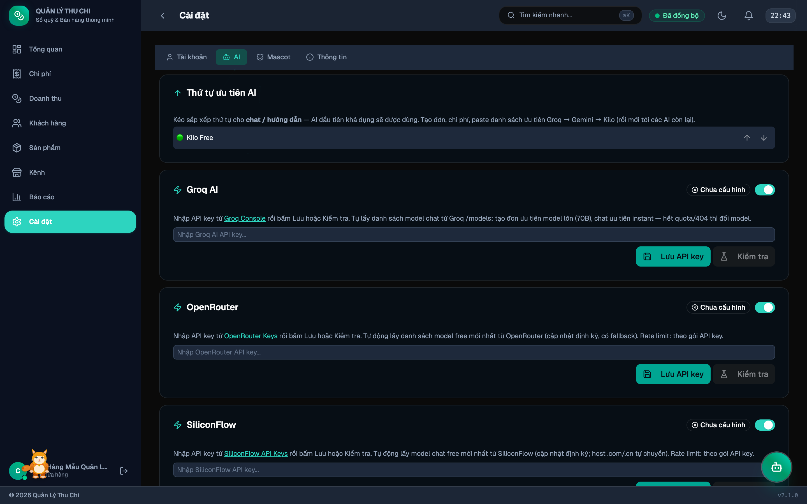
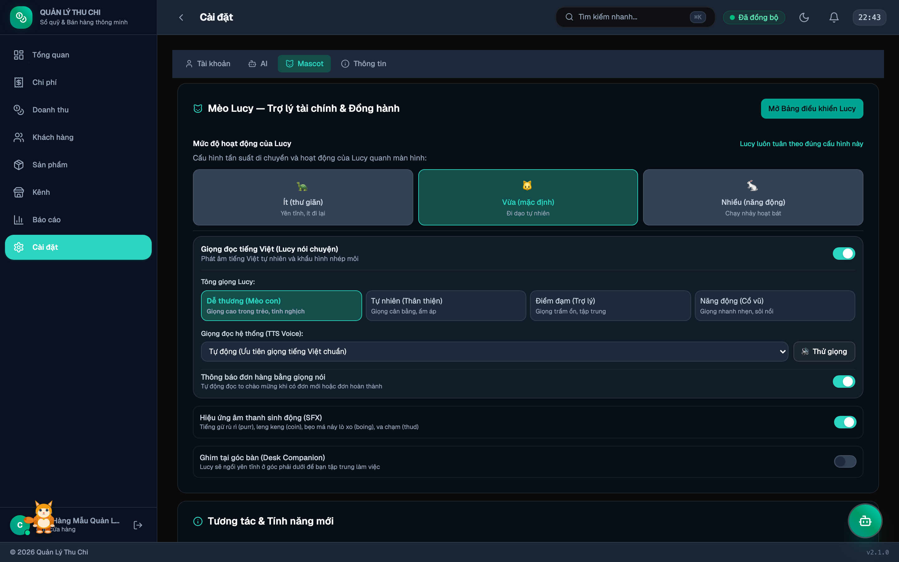
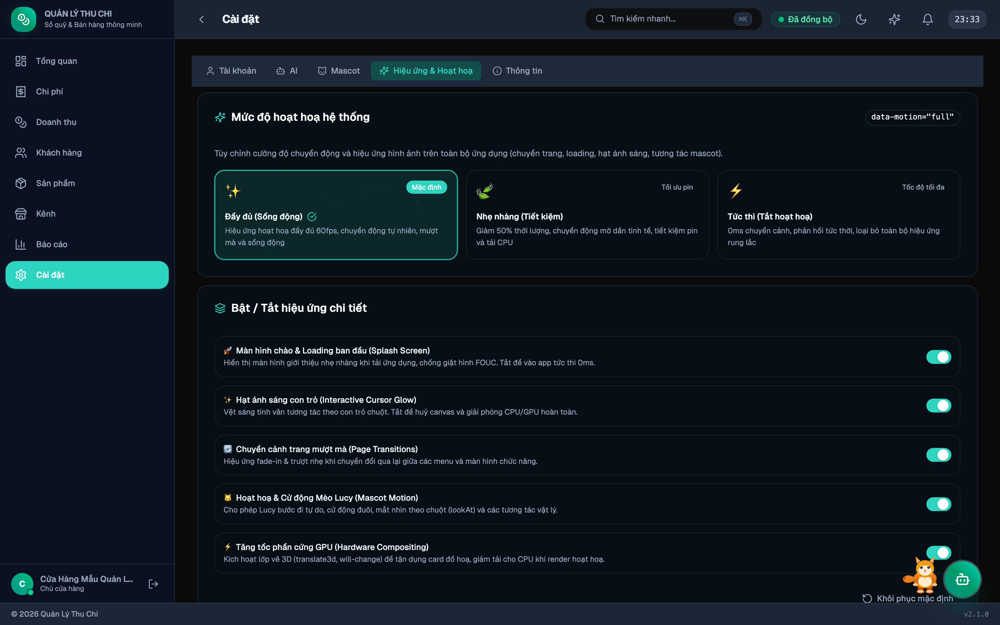

# Cài đặt

Truy cập qua sidebar: **Cài đặt** (biểu tượng ⚙️).

---

## 1. Tab Tài khoản & Sổ chung

- **Hồ sơ cửa hàng**: Xem và chỉnh sửa tên cửa hàng, số điện thoại, địa chỉ kinh doanh.
- **Đổi mật khẩu**: Cập nhật mật khẩu tài khoản Supabase an toàn.
- **Sổ chung (Supabase Cloud)**: Trạng thái đồng bộ, tạo sổ dùng chung hoặc tham gia sổ của gia đình/cửa hàng qua mã mời.

---

## 2. Tab AI Providers

Quản lý toàn diện các mô hình trí tuệ nhân tạo:

- **Kilo Free (kilo-auto/free)**: Miễn phí hoàn toàn qua Kilo Gateway, không cần API key.
- **Gemini API**: Nhập API key từ Google AI Studio, tự động chọn model Flash/Flash-Lite tốt nhất.
- **Groq / OpenRouter / SiliconFlow**: Kết nối các nhà cung cấp AI hiệu năng cao.
- **AI Cục bộ (WebLLM)**: Chạy mô hình Qwen3-4B trực tiếp trên máy thông qua WebGPU.
- **Sắp xếp thứ tự ưu tiên**: Kéo thả / bấm nút để ưu tiên provider xử lý theo ý muốn.
- **Chuẩn hoá dữ liệu nhập liệu (AI Data Standardization)**: Nút thao tác nhanh mở hộp thoại quét và chuẩn hoá dữ liệu chi phí, khách hàng, sản phẩm và đơn hàng. Xem chi tiết: [Chuẩn hoá Dữ liệu AI](Chuẩn-hoá-Dữ-liệu).

---

## 3. Tab Mascot (Linh vật Nấm)

Cấu hình trợ lý tài chính và bạn đồng hành ảo:

- **Mức độ hoạt động**:
  * **Ít (thư giãn)**: Nấm yên tĩnh, ít đi lại.
  * **Vừa (mặc định)**: Đi dạo tự nhiên quanh bàn làm việc.
  * **Nhiều (năng động)**: Chạy nhảy hoạt bát, nhiều biểu cảm.
  * *Lưu ý: Nấm luôn tuân thủ nghiêm ngặt mức độ đã cấu hình, không bị tự ý thay đổi khi tương tác.*
- **Giọng đọc tiếng Việt (Nấm nói chuyện)**:
  * Bật/tắt phát âm tiếng Việt tự nhiên và mấp máy khẩu hình.
  * Lựa chọn 4 âm sắc: **Dễ thương**, **Tự nhiên**, **Điềm đạm**, **Năng động**.
  * Chọn giọng đọc TTS trong hệ thống kèm nút **🔊 Thử giọng**.
- **Thông báo đơn hàng bằng giọng nói**: Tự động đọc to chúc mừng khi có đơn mới hoặc khi đơn hoàn thành.
- **Hiệu ứng âm thanh (SFX)**: Bật/tắt âm thanh leng keng, meow, purr. Khi tắt, Nấm tuyệt đối không phát ra âm thanh.
- **Ghim tại góc bàn (Desk Companion)**: Giữ cố định Nấm ở góc phải dưới màn hình.

Xem chi tiết tại: [Trợ lý Linh vật Mèo Nấm](Mèo-Nấm).

---

## 4. Tab Hiệu ứng & Hoạt hoạ (Motion Settings)

Quản lý toàn bộ hiệu ứng chuyển động và hoạt hoạ trong ứng dụng:

- **3 Chế độ hoạt hoạ chính**:
  * 🌟 **Đầy đủ (Full)**: Hiệu ứng mượt mà tối đa, đầy đủ chuyển cảnh, vệt sáng con trỏ và hoạt hoạ linh vật.
  * 🍃 **Tối giản (Reduced)**: Giảm thiểu chuyển động, thời gian hiệu ứng rút ngắn 50%, tuân thủ tiêu chuẩn tiếp cận WCAG.
  * ⚡ **Tắt toàn bộ (Off)**: Tắt 100% hoạt hoạ và chuyển cảnh, phản hồi tức thì 0ms, tiết kiệm tối đa CPU/GPU và pin thiết bị.
- **5 Công tắc tinh chỉnh**:
  * **Vệt sáng con trỏ (Cursor Glow)**: Bật/tắt hiệu ứng quầng sáng theo sau chuột.
  * **Hoạt hoạ Splash & Loading**: Bật/tắt hiệu ứng xoay khi tải ứng dụng.
  * **Chuyển cảnh trang (Page Transitions)**: Hiệu ứng trượt mượt mà giữa các màn hình.
  * **Hoạt hoạ Linh vật (Mascot Animations)**: Chuyển động đi lại và biểu cảm của Mèo Nấm.
  * **Tăng tốc phần cứng GPU**: Ép buộc render bằng GPU để tối ưu khung hình.
- **Khung thử nghiệm (Motion Playground)**: Tương tác trực tiếp với các nút Bounce, Spin, Pulse, Slide để kiểm tra tốc độ phản hồi chuyển động thực tế.

---

## 5. Tab Thông tin

- Phiên bản ứng dụng hiện tại: **v2.3.0**.
- Công nghệ sử dụng: React 19, Vite 6, Tailwind CSS v4, Zustand 5, IndexedDB, WebLLM, Playwright.

---

→ [Trang chủ Wiki](Home) · [Trợ lý Linh vật Nấm](Mèo-Nấm) · [Chuẩn hoá Dữ liệu](Chuẩn-hoá-Dữ-liệu)
