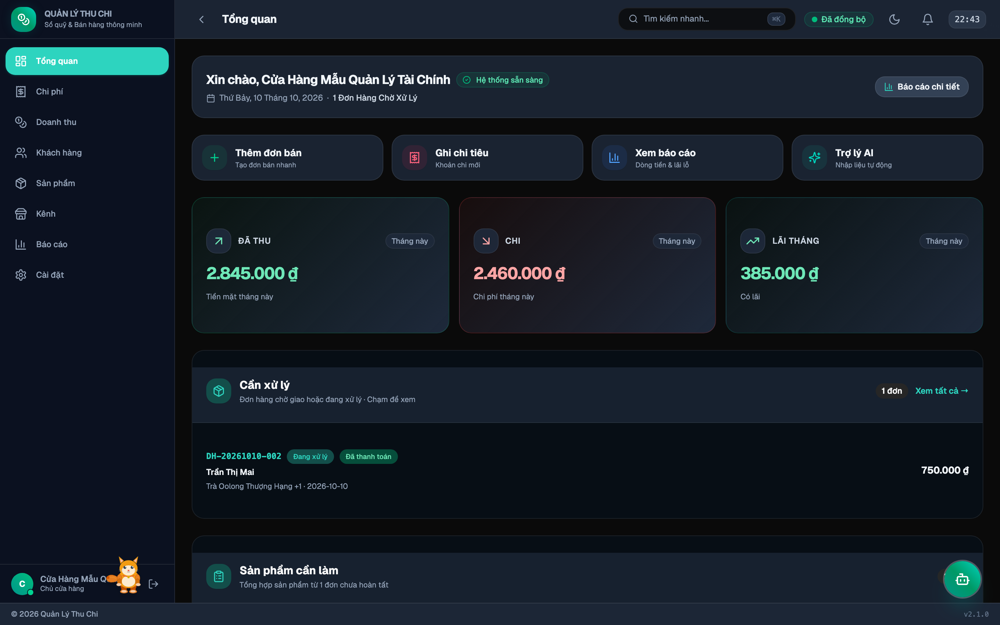

# Dashboard — Tổng quan

Trang chủ khi mở ứng dụng, hiển thị bức tranh toàn cảnh về sức khoẻ tài chính của cửa hàng.

---

## 1. Hành động nhanh (Quick Actions)
- **Thêm đơn bán**: Mở form tạo đơn hàng nhanh chóng.
- **Ghi chi tiêu**: Ghi nhận khoản chi tức thời với danh mục và phương thức thanh toán.
- **Xem báo cáo**: Điều hướng tới các biểu đồ phân tích chuyên sâu.

---

## 2. Các chỉ số Tài chính Trọng yếu (KPI Cards)

| Chỉ số | Ý nghĩa |
|:---|:---|
| **ĐÃ THU** | Tổng số tiền đã thanh toán thực tế trong kỳ (tiền mặt / chuyển khoản về túi) |
| **CHI PHÍ** | Tổng chi phí hoạt động đã thanh toán |
| **CẦN XỬ LÝ** | Danh sách đơn hàng đang chờ giao hoặc đang xử lý cần lưu ý |
| **SẢN PHẨM CẦN LÀM** | Tổng hợp số lượng sản phẩm từ các đơn chưa hoàn thành |

---

## 3. Bạn đồng hành Mèo Lucy trên Dashboard

- Mèo Lucy tự động xuất hiện ở góc dưới màn hình làm việc, đồng hành cùng chủ tiệm.
- Lucy chủ động đưa ra lời khuyên thu chi hôm nay, nhắc nhở kỷ luật tài chính và cung cấp [Chế độ tập trung Pomodoro](Mèo-Lucy).
- Bấm vào Lucy hoặc nhấp chuột phải để mở [Bảng điều khiển Lucy](Mèo-Lucy).

---

→ [Trang chủ Wiki](Home) · [Quản lý Doanh thu](Quản-lý-Doanh-thu) · [Quản lý Chi phí](Quản-lý-Chi-phí)
