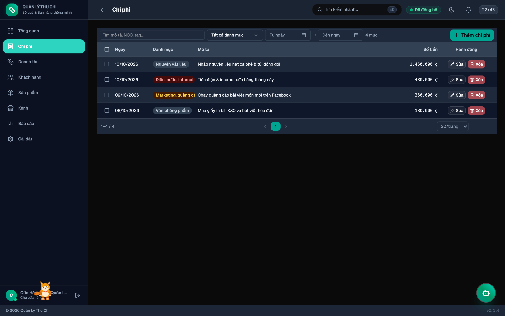

# Quản lý Chi phí

Ghi chép và phân bổ chính xác từng khoản chi tiêu trong hoạt động vận hành cửa hàng.

---

## 1. Xem danh sách chi phí
Bảng hiển thị các cột:
- **Ngày**: Thời điểm chi trả.
- **Danh mục**: Phân loại chi phí trực quan (Nguyên vật liệu, Điện nước, Marketing, Thuê mặt bằng, v.v.).
- **Mô tả & Nhà cung cấp**: Ghi chú cụ thể mục đích chi và đối tác nhận tiền.
- **Số tiền**: Định dạng tiền tệ VND rõ ràng.
- **Phương thức & Trạng thái**: Tiền mặt, Chuyển khoản, Thẻ tín dụng; Đã chi hoặc Chờ thanh toán.

---

## 2. Thêm mới chi phí
1. Bấm nút **[➕ Thêm chi tiêu]** ở thanh công cụ.
2. Chọn danh mục phù hợp trong 10 danh mục chuẩn hoá.
3. Nhập số tiền, ngày chi, phương thức thanh toán và nhà cung cấp.
4. Bấm **Lưu chi phí**.

---

## 3. Nhập liệu tự động bằng AI
- **Chụp ảnh hoá đơn (OCR)**: Mở khung trò chuyện AI hoặc đính kèm ảnh chụp bill để AI tự động trích xuất số tiền, ngày và gợi ý danh mục chuẩn xác.
- **Nhập hàng loạt qua file**: Đính kèm file CSV hoặc Excel hoá đơn vào khung chat AI.

---

→ [Trang chủ Wiki](Home) · [Trợ lý AI](Trợ-lý-AI) · [Báo cáo & Phân tích](Báo-cáo)
