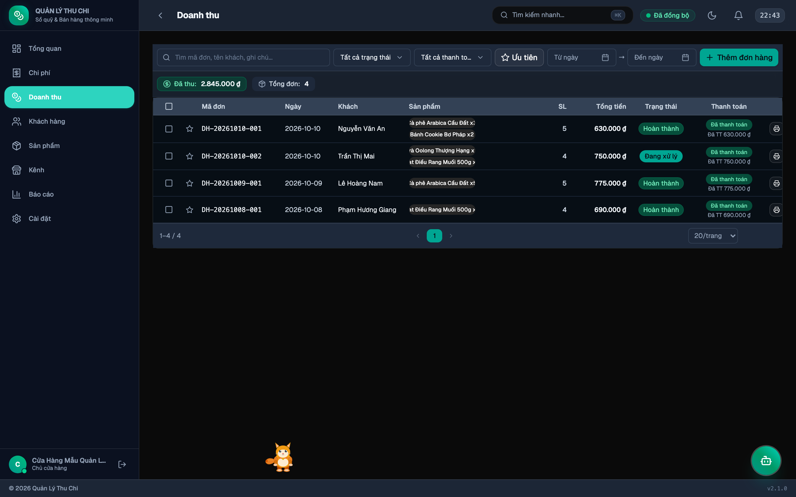

# Quản lý Doanh thu & Đơn hàng

Màn hình quản lý chi tiết toàn bộ đơn hàng, trạng thái thanh toán và giao vận.

---

## 1. Xem danh sách đơn hàng
Bảng quản lý trực quan bao gồm các cột thông tin:
- **Mã đơn**: Mã định danh duy nhất (ví dụ: `DH-202610-001`).
- **Ngày**: Ngày phát sinh đơn hàng.
- **Khách hàng**: Tên khách hàng (hoặc Khách vãng lai).
- **Sản phẩm**: Chi tiết từng món hàng, đơn giá, số lượng.
- **SL (Số lượng)**: Tổng số món trong đơn.
- **Tổng tiền**: Giá trị thực tế sau khi tính giảm giá và phí ship.
- **Trạng thái**: Mới tạo, Đang xử lý, Hoàn thành, Đã huỷ.
- **Thanh toán**: Đã thanh toán, Đã cọc, Chưa thanh toán.

---

## 2. Tạo đơn hàng mới
1. Bấm nút **[➕ Thêm đơn hàng]** ở góc trên phải.
2. Chọn khách hàng có sẵn hoặc tạo nhanh khách hàng mới.
3. Thêm các sản phẩm, điền số lượng và đơn giá.
4. Điều chỉnh giảm giá và phí vận chuyển (chọn người chịu ship: Khách hoặc Shop).
5. Bấm **Lưu đơn hàng**.

> **🎙️ Lucy thông báo**: Khi tạo đơn hàng thành công, Mèo Lucy sẽ tự động cất giọng chúc mừng bằng tiếng Việt và đọc to giá trị đơn hàng (nếu đang bật tuỳ chọn thông báo đơn hàng).

---

## 3. Hoàn thành đơn hàng
- Khi đơn hàng được chuyển sang trạng thái **"Hoàn thành"**, hệ thống tự động ghi nhận doanh thu thực tế.
- Mèo Lucy sẽ tự động reo vui ăn mừng, phát âm thanh chúc mừng bằng tiếng Việt.

---

## 4. Bộ lọc & Hành động hàng loạt
- **Lọc thông minh**: Tìm kiếm theo mã đơn, tên khách, ngày đặt, trạng thái đơn, trạng thái thanh toán hoặc lọc chỉ các đơn ưu tiên ⭐.
- **Thao tác hàng loạt**: Tích chọn nhiều đơn để hoàn thành hoặc xuất dữ liệu nhanh.

---

→ [Trang chủ Wiki](Home) · [Trợ lý Linh vật Lucy](Mèo-Lucy)
