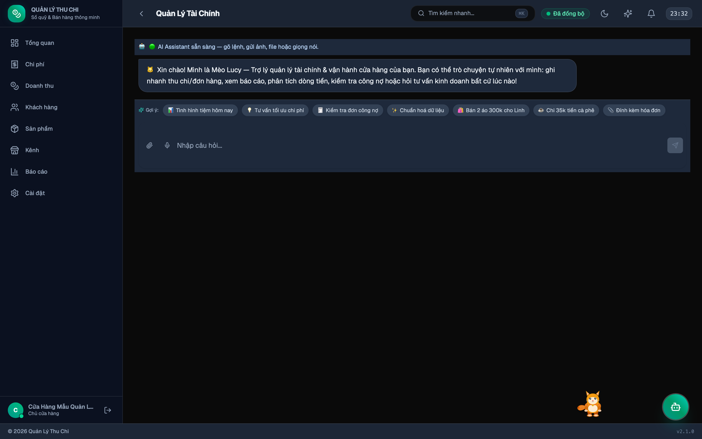

# Trợ lý AI Thông minh

Trò chuyện trực tiếp với AI để tự động nhập liệu, phân tích sổ sách tài chính và điều hướng toàn bộ ứng dụng bằng ngôn ngữ tự nhiên.

---

## 1. Mở khung trò chuyện AI
- Bấm biểu tượng **FAB 🤖** ở góc phải dưới mọi màn hình.
- Hoặc chọn mục **AI** trên thanh điều hướng bên trái (sidebar).
- Hoặc bấm nút **"Mở khung trò chuyện chi tiết với Lucy"** ngay trên [Bảng điều khiển Lucy](Mèo-Lucy).

---

## 2. Các tác vụ AI hỗ trợ

| Tác vụ | Câu lệnh mẫu |
|:---|:---|
| **Tạo đơn hàng** | *"Bán 3 cà phê Cầu Đất 150k cho anh An, giảm 20k, đã thanh toán"* |
| **Ghi nhận chi phí** | *"Chi 480k tiền điện và mạng hôm nay bằng chuyển khoản"* |
| **Phân tích tài chính** | *"Phân tích doanh thu và chi phí tuần này"* |
| **Tra cứu sổ sách** | *"Tháng này đã chi bao nhiêu tiền nguyên vật liệu?"* |
| **Chuẩn hoá dữ liệu** | *"Chuẩn hoá dữ liệu"* hoặc *"Làm sạch sổ sách"* |
| **Điều hướng thông minh** | *"Mở báo cáo lợi nhuận"* hoặc *"Vào cài đặt linh vật"* |

---

## 3. Nhập liệu Đa phương thức (Multimodal)
- **Văn bản**: Nhập văn bản tự nhiên, không cần theo cú pháp cứng nhắc.
- **Giọng nói (Voice Input)**: Bấm biểu tượng micro 🎤 để nói trực tiếp bằng tiếng Việt.
- **Hình ảnh / Hóa đơn (OCR)**: Kéo thả hoặc đính kèm ảnh bill, biên lai thanh toán để AI tự quét dữ liệu.
- **File bảng tính / CSV**: Tải file lên để AI đối chiếu và thêm hàng loạt vào hệ thống.

---

## 4. Chuẩn hoá Dữ liệu Nhập liệu Tự động (AI Data Standardization)

Khi nhập liệu vội vàng, thông tin thường bị lỗi: thiếu dấu tiếng Việt, số điện thoại lẫn khoảng trắng hoặc tiền tố quốc tế, danh mục chi phí gán bừa, đơn vị tính lộn xộn. AI Trợ lý tích hợp module quét và chuẩn hoá toàn diện:

- **Cách kích hoạt**:
  * Bấm nút **Sparkles ✨** trên thanh Header.
  * Nhấn `⌘K` hoặc `Ctrl+K` và chọn **✨ Chuẩn hoá dữ liệu (AI)**.
  * Nhắn tin trực tiếp với Trợ lý AI hoặc Mèo Lucy: *"chuẩn hoá dữ liệu"* / *"làm sạch sổ sách"*.
  * Vào **Cài đặt → AI Providers → Chuẩn hoá dữ liệu nhập liệu (AI)**.
- **Cơ chế**: Hệ thống tự động so sánh bản ghi cũ và bản ghi sau chuẩn hoá dạng **Diff Trước ➔ Sau**, cho phép người dùng kiểm tra kỹ lưỡng trước khi quyết định áp dụng vào sổ cái.

Xem hướng dẫn chi tiết tại: [Chuẩn hoá Dữ liệu AI](Chuẩn-hoá-Dữ-liệu).

---

→ [Trang chủ Wiki](Home) · [Kết nối AI Provider](Kết-nối-AI-Provider) · [Trợ lý Linh vật Lucy](Mèo-Lucy) · [Chuẩn hoá Dữ liệu AI](Chuẩn-hoá-Dữ-liệu)
